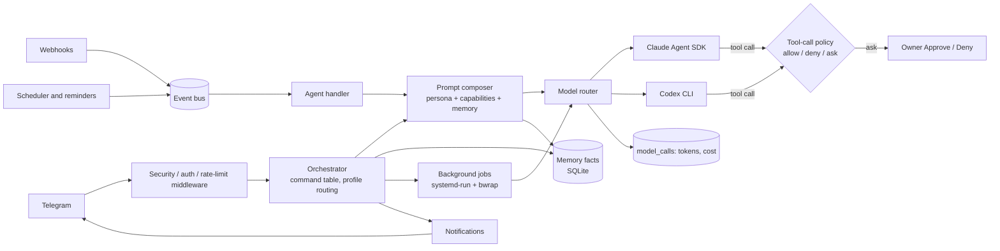
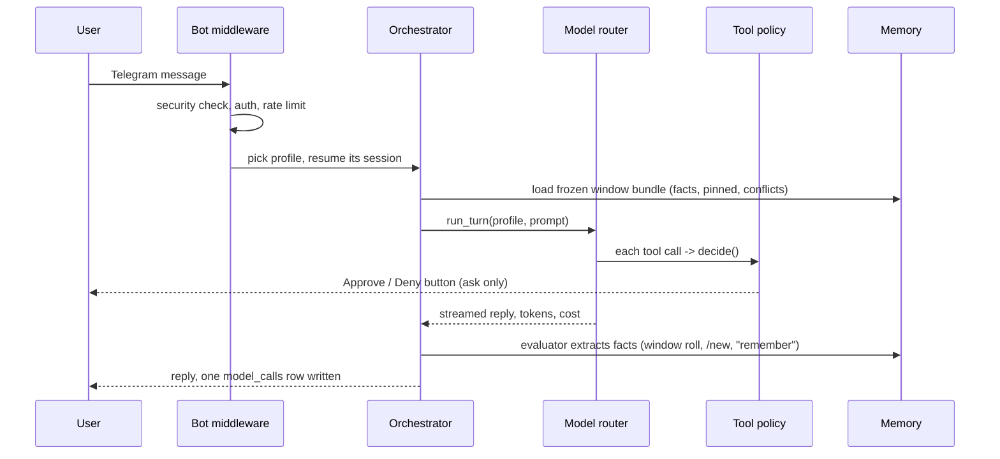

# Devvy

[](https://opensource.org/licenses/MIT)
[](https://www.python.org/downloads/)

**A self-hosted multi-agent platform that lives in Telegram.** One install runs several
isolated agents (profiles), each with its own persona, workspace, sandbox level and long-term
memory. They run on [Claude Code](https://claude.ai/code) or the OpenAI Codex CLI through one
model router, obey a single tool-call policy with owner approval buttons, run background jobs
that survive restarts, keep a task board and reminders, and take work from webhooks.

It is a **household appliance, not a service**: one owner, one machine, one LLM login, a few
trusted users. Repository: [itsoneword/devvy-bot](https://github.com/itsoneword/devvy-bot).

[What you get](#what-you-get) · [Architecture](#architecture) · [Message flow](#how-a-message-flows) ·
[Agents](#agents-profiles) · [Backends](#backends-and-the-model-router) · [Policy](#one-tool-call-policy) ·
[Memory](#memory) · [Context](#context-window-management) · [Jobs](#background-jobs) ·
[Reminders](#reminders-and-scheduler) · [Tasks](#task-board) · [Keys](#key-store) ·
[Voice](#voice) · [Onboarding](#onboarding) · [Webhooks](#webhooks-and-the-event-bus) ·
[Limits](#feature-table-and-honest-limits) · [Quick Start](#quick-start)

---

## What you get

| | |
|---|---|
| **Multi-agent** | Profiles with separate workspace, persona, memory and session; switch with one command. |
| **Two backends** | Claude Agent SDK and Codex CLI behind one `AgentBackend` protocol. |
| **One model router** | Every model call is recorded: purpose, harness, version, model, tokens, cost. |
| **One policy** | Allow / deny / ask for every tool call on both backends; owner Approve/Deny buttons. |
| **Memory** | Dated facts, pinned constraints, conflict flags, recall, family scope, audit / forget / correct. |
| **Long conversations** | Context windows roll at a token threshold and are re-seeded from memory. |
| **Background jobs** | Detached systemd units in a bubblewrap sandbox; they outlive a bot restart. |
| **Reminders + cron** | Time-zone-correct one-shot and recurring items, created by agents. |
| **Task board** | Markdown task files shared by the owner and the agents. |
| **Key store** | `/setkey` keeps API keys out of chat history and out of model context. |
| **Voice, files, images** | Voice transcription (4 providers), file and image handling. |
| **Webhooks** | GitHub HMAC and Bearer-token webhooks, deduplicated, routed to an agent. |

---

## Architecture



State is SQLite (Alembic migrations run at boot) plus plain files for personas, workspaces and
the task board. One Python process, plus the detached job units.

## How a message flows



---

## Agents (profiles)

A profile is an isolated agent: its own `working_dir`, `memory_dir`, `persona` file and
auto-resuming session (`config/profiles.yaml`, example in
[`config/profiles.example.yaml`](config/profiles.example.yaml)).

- **Personas** are plain files injected by the prompt composer.
- **Sandbox vs full access**, per profile. `sandbox: true` jails bash to the workspace with no
  network; `sandbox: false` is a trusted admin profile. A full-access profile can never be open
  to guests (checked at load). Codex runs confined to workspace + `extra_dirs` + `/tmp` unless
  the profile is `unrestricted`.
- **`extra_dirs:`** lets a sandboxed profile write to named folders (a notes vault, another
  checkout) without turning the sandbox off.
- **Roles.** `permission_policy.allowed_roles` decides whether owners only, or owners and
  guests, may enter a profile. Guests get their own workspace and memory scope.
- **Switching.** One command per profile (`/devops`, `/general`, …), or `/agents` (switch,
  `➕ New agent`, `⚙ Manage` to enable / disable). `/new` starts a fresh session.

Shipped templates: `devops`, `general`, `chef`, `coach`, `pm`, `channel`.

```bash
python3 scripts/install_profiles.py --list
python3 scripts/install_profiles.py --add coach
sudo systemctl restart claude-bot          # profiles load at boot
```

`/agents → ➕ New agent` runs the `new-agent` interview (purpose, who may use it, which extra
folders) and scaffolds the profile. See
[`data/templates/profiles/README.md`](data/templates/profiles/README.md).

## Backends and the model router

- `ClaudeIntegration` wraps the Claude Agent SDK; the Codex CLI backend lives in
  `src/agent_backends/`. Handlers only touch the `AgentBackend` protocol, and `/model`
  switches backend and model per user (Codex choices come from the account's live catalog).
- `src/model_router/` is the single entry point: `run_turn` for an agent turn, `complete` for a
  plain prompt-in / text-out call. Each call writes one `model_calls` row (purpose, harness,
  version, model, input / output / cache tokens, cost). The same pass records the turn's
  tool calls (main agent and subagents) in `tool_calls`; the owner reads them with `/trace`
  or `scripts/trace`.
- Background jobs run `scripts/agentjob`, the same turn out of process, so they are recorded
  the same way.
- `/usage` reads that ledger (`/limits` shows Codex account limits). Rolling-24h caps per owner and per guest use the
  reported cost; **Codex reports none, so caps do not bite there.**
- `tests/unit/test_no_stray_model_calls.py` fails the build if code starts a model CLI outside
  the router.

## One tool-call policy

`src/security/policy.py::decide()` returns **allow**, **deny** or **ask** for every tool call.
The Claude pre-tool hook calls it in-process; the Codex hook reaches it over a loopback
bridge. A rule added once holds on both backends.

| Outcome | Examples |
|---|---|
| **deny** | credential files, `.env`, SSH keys, system paths (`/etc/shadow`, `/boot`, …), other users' workspaces, guest read scope |
| **ask** | deletion, sending data out, system-path changes on full-access profiles: the owner gets **Approve / Deny** buttons; unanswered requests time out |
| **allow** | everything else |

Before the agent runs: input validation, a token-bucket rate limiter and an audit log. Path
policy is a denylist (default) or a single-directory allowlist (`APPROVED_DIRECTORY`).

The **Confirm risky action** card also carries an independent plain-language explanation of
the command and a verdict from a cheap model that never sees the agent's reasoning. It is
advisory: only your tap approves.

**Self-modification tiers** (`src/bot/features/self_modify.py`): Tier 0 files outside the bot
are ungated; Tier 1 data / config is freely editable; Tier 2 source and dependencies need
owner approval and a restart.

## Memory

Per profile and per user, SQLite-backed (`src/storage/memory_repository.py`, `src/evaluator/`).

- **Facts are atomic, verbatim and dated.** `user_fact`s are injected at window start;
  `conversation_result`s (research, decisions) appear only as dated one-line pointers.
- **Pinned constraints** are a separate tier that is always injected.
- **Invalidate, don't overwrite.** A superseded fact is closed with a pointer to its successor;
  the chain is the history.
- **Conflict flags.** Contradicting facts reach the agent as a conflict pair instead of one
  silently winning.
- **Evaluator.** A model pass extracts facts at window roll, on `/new` and on "remember", with
  quality and episodic-noise guards, plus a consolidation pass for oversized scopes.
- **Agent tools:** `remember`, `recall`, `recall_conversation`, `memory_list`,
  `memory_forget`, `memory_correct`; `/memory` gives you the same view.
- **Family scope.** `/family` groups users; family facts are a separate, labelled block shared
  across members, while personal facts stay private.

## Context window management

Conversations end by **size, not time**. When real context (input + cache read + cache
creation) reaches `WINDOW_REFRESH_THRESHOLD_TOKENS` (default 150 000; on Codex clamped to 80 %
of the model's window), the window rolls: facts are extracted, a fresh backend session starts
and is seeded with the memory bundle plus the recent tail. An oversized facts snapshot
(`BUNDLE_FACTS_BUDGET_CHARS`) triggers consolidation, never truncation.

## Background jobs

`job_start` / `scripts/bgjob` launch work as a transient `systemd-run --user` unit inside a
`bubblewrap` sandbox (it refuses to run unconfined). The job is independent of the bot
process, so a bot restart does not kill it, and on completion it can run a resumed turn in the
owning profile to report back. `job_list` and `job_output` inspect them. Needs Linux, a systemd
user manager and `bwrap`.

## Reminders and scheduler

- **Items** (`src/items/`): agent-created reminders, one-shot (`at`) or recurring (`cron`),
  stored with the assignee's time zone so recurring ones do not drift at DST. `/reminders`,
  `/schedules`.
- **Scheduler** (APScheduler, `ENABLE_SCHEDULER`): cron-driven agent runs persisted in SQLite,
  delivered through the rate-limited notification service.

## Task board

The `task_add` / `task_list` / `task_done` agent tools and `/tasks` share one board of
markdown files with `dv-xxxx` ids (`src/storage/deviz_board.py`). Plain files: you can edit,
grep or version them by hand.

### Task pump (opt-in)

`scripts/taskpump` works the board unattended: a task you move to `in_progress`
is analysed, you get a short plan and up to three questions in Telegram, your
answer arrives as an ordinary chat message, then it designs tests and implements
on a `pump/<id>` branch in a git worktree. Separate **architect** (checks the plan),
**review** (can send a build back once) and **acceptance** (runs the product) jobs
bracket the build, and small tasks skip what they do not need. `deps:` and `start_at:`
in a task's frontmatter hold its launch, and a pinned status post shows what runs, what
needs you and what waits. Merging stays yours. It is off until
you enable the timer (`deploy/taskpump.timer.template`, rendered by
`scripts/render_deploy.py`); other repos' boards are listed in your own
`config/taskpump/boards.json` (see `boards.example.json`). Details:
`docs/taskpump.md`.

### deviz

The board format comes from [deviz](https://github.com/itsoneword/deviz), a
Claude Code plugin: `claude plugin marketplace add itsoneword/deviz`, then
`claude plugin install deviz@deviz`. Treat it as a format, not a fixed tool.
The contract is `.deviz/tasks/*.md`: frontmatter `id`, `title`, `status`
(`todo`, `in_progress`, `review`, `waiting_user`, `done`), `priority`,
`assignee`, `labels`, `deps`, `parent`, `created`, `updated`, and a markdown
body. The kanban UI is optional; an agent may adapt or rewrite the tooling
around those files to suit its needs.

## Key store

`/setkey` stores API keys in `secrets/tools/<service>.env` (mode 0600) from bot code,
**before any model sees the message**. The directory is denied to every agent, display is
masked to the last four characters, and keys reach a tool only as subprocess environment
(`scripts/withkeys` runs a command with them and redacts its output). `/keys` lists,
`/delkey` removes.

## Voice

Voice messages are transcribed by ElevenLabs, OpenAI, Mistral (Voxtral) or local
faster-whisper (keyless); enable with `ENABLE_VOICE_MESSAGES`, configure with `/voice`. Images
and files are handled by `src/bot/features/`.

## Onboarding

First contact runs a short conversational setup (`/setup`, `src/onboarding/`): name,
language, time zone, preferences. A model extracts structured answers; they become the
persona's identity block and seed starter memory facts.

## Webhooks and the event bus

`POST /webhooks/{provider}` (FastAPI, `ENABLE_API_SERVER`) verifies a GitHub HMAC-SHA256
signature or a Bearer secret, dedupes atomically in the `webhook_events` table, and publishes
a `WebhookEvent` on the async event bus. The agent handler turns events (webhooks, scheduled
runs, user messages) into agent turns and publishes the response for notification delivery.

## Also included

`/servercheck` server monitoring, project threads (one Telegram topic per project), a places
knowledge-base MCP daemon ([`src/channel_intel/`](src/channel_intel/README.md)), an
LLM-analytics service (`src/llm_analytics/`) for answer scoring, and an MCP seam
(`config/mcp/`) for mounting your own tool servers per profile.

---

## Feature table and honest limits

This table covers only what is in this repository. About other projects, only what their
READMEs list at a glance is known here: [OpenClaw](https://github.com/openclaw/openclaw)
describes a gateway with several messaging channels and companion apps, and
[Hermes Agent](https://github.com/NousResearch/hermes-agent) describes CLI plus messaging and
installs on several operating systems. Read both; this table makes no other claim about them.

| Capability | Devvy |
|---|---|
| Chat surface | Telegram only (topics supported) |
| Platforms | Linux + systemd only; no macOS / Windows / Docker |
| Agents | Many profiles, one process |
| Backends | Claude Agent SDK, Codex CLI |
| Cost ledger | Per call, all callers; Codex reports no cost |
| Tool policy | Single allow / deny / ask for both backends |
| Memory | Dated facts, supersede history, conflicts, family scope |
| Users | Owner + guests; guests isolated by convention, not hardened |
| Jobs | Survive bot restarts; bubblewrap required |
| Install | From source only (no PyPI) |

---

## The money and trust model — read this first

**One LLM account serves the whole installation.** Devvy runs as a single OS user with a single
Claude (or Anthropic API) login. There is no per-user credential: every Telegram user you allow
spends **your** subscription quota or **your** API bill. That is by design, and it is not going
to change — it is what makes "here, use my bot" a one-line action.

**The bot has your filesystem.** It runs as an ordinary service account with that account's
full access (a denylist blocks obvious system paths like `/etc/shadow` and SSH keys; there is an
optional single-directory allowlist mode). Anyone allowed to talk to the bot can, in principle,
get it to read or change anything that account can.

**Spending caps exist, but do not treat them as a wall.** `CLAUDE_MAX_COST_PER_USER` and the
guest tier cap a rolling 24h spend per person, and the watchdog warns you hourly. They are
enforced from the cost the Claude backend reports; the OpenAI Codex backend reports none, so on
that backend the caps do not bite.

**Guests are isolated by convention, not by a sandbox.** A guest gets a restricted role, their
own workspace and their own memory scope. That protects against accident, not against someone
who is trying. Devvy is not hardened against a hostile user who has been let in.

**So: install it for yourself and your household.** Do not hand the username to strangers, and
do not put it in a public channel. See [SECURITY.md](SECURITY.md).

---

## Quick Start

You need a Linux machine with systemd (a small VPS is plenty) and a Telegram bot token from
[@BotFather](https://t.me/botfather). Everything else — Python, Poetry, Node, the `claude` CLI —
is checked by the installer, which prints the exact command for anything missing.

```bash
git clone https://github.com/itsoneword/devvy-bot.git
cd devvy-bot
./install.sh --token 1234567890:ABC-DEF1234ghIkl-zyx57W2v1u123ew11
```

The installer then walks you through the rest:

1. **Preflight** — a ✔/✘ table of dependencies, and an offer to install the missing ones
   (nothing is installed without you saying yes).
2. **"Send `/start` to @yourbot"** — it waits for your message and records you as the owner.
   Nobody else can use the bot until you add them.
3. **Claude login** — log in right there in the terminal, paste an `ANTHROPIC_API_KEY`, or skip
   and do it later. See below.
4. It writes `.env`, creates `config/profiles.yaml`, installs the systemd unit, starts the
   service and checks that the bot actually came up.

Then message your bot. Re-running `./install.sh` is safe: it never overwrites `.env`, the
database, memory or workspaces.

Useful flags: `--dry-run` (print every action, change nothing), `--owner-id <id>` (headless),
`--no-service`, `--skip-auth`, `--uninstall`, `--help`.

Full detail — prerequisites, what the installer touches, uninstall, troubleshooting keyed to
each preflight failure — is in [docs/installation.md](docs/installation.md).

> Installed **from source only**. Devvy is not on PyPI and there is no `pip install` route.

### Giving the bot an LLM login

Three ways, all equivalent — pick one:

| When | How |
|---|---|
| During install | Choose "log in now"; the installer runs `claude auth login` in your terminal. |
| Later, from Telegram | Send `/auth` and follow the buttons. Works for Claude and Codex. |
| By hand | Put `ANTHROPIC_API_KEY=sk-ant-...` in `.env` and restart the service. |

The bot starts and runs without a login — it just cannot answer until one of the three is done.

## Talking to it

There is one interaction mode: conversation. No command syntax to learn.

```
You: What changed in this repo since Friday?
Bot: 📖 Read  💻 Bash: git log --since=friday
     [summary]

You: Add a retry decorator to the HTTP client and run the tests
Bot: ✏️ Edit: http_client.py
     💻 Bash: poetry run pytest tests/ -v
     [diff + test results]
```

Commands, in the Telegram menu: `/start`, `/new`, `/agents`, `/stop`, `/resume`, `/restart`,
`/help`, `/status`, `/usage`, `/model`, `/tasks`. Owner-only `/trace` shows what a turn did.

Registered but unlisted — type them and they work: `/auth`, `/verbose`, `/memory`, `/repo`,
`/servercheck`, `/schedules`, `/sessions`, `/adduser`, `/rmuser`, `/family`, `/diag`,
`/identity`, plus one switch command per profile (`/devops`, `/general`, …).

`/help` lists exactly what *you* can run, generated from the same table that builds the menu, so
it cannot drift. Owner-only commands (`/restart`, `/auth`, `/adduser`, …) are hidden from guests.

`/verbose 0|1|2` controls how much of Claude's tool use is shown: quiet, normal, or detailed.
`/model` switches between the Claude Code and OpenAI Codex backends; Codex choices come from the account's live entitlement catalog.

## Configuration

`.env` holds everything. It is generated by the installer, and
[`.env.example`](.env.example) is generated from `src/config/settings.py`, so it always lists
every variable with its real default.

The ones people actually change:

```bash
ALLOWED_USERS=123456789            # owners (full access)
GUEST_USERS=987654321              # guests (restricted role, isolated workspace)
CLAUDE_MAX_COST_PER_USER=10.0      # rolling 24h USD cap per owner
CLAUDE_MAX_COST_PER_USER_GUEST=2.0 # ... and per guest
VERBOSE_LEVEL=1                    # 0 quiet, 1 normal, 2 detailed
APPROVED_DIRECTORY=                # set = lock the bot to one directory
```

Find your Telegram user id by messaging [@userinfobot](https://t.me/userinfobot). Full
reference: [docs/configuration.md](docs/configuration.md).

## Requirements and limits

- **Linux with systemd only.** The bot ships as a systemd unit, self-restarts through a sudoers
  rule, and runs background jobs as transient `systemd --user` units inside a `bubblewrap`
  sandbox. macOS and Docker have none of those three, so supporting them means porting the
  background-job subsystem, not writing a Dockerfile. Not done, not planned for v1.
- Python 3.11+, Node 18+ (the `claude` CLI is a Node app), Poetry, git.
- A Claude subscription or an Anthropic API key.

## Documentation

| | |
|---|---|
| [Installation](docs/installation.md) | Prerequisites, what the installer touches, uninstall, troubleshooting |
| [Setup](docs/setup.md) | First run, optional features, the manual install route |
| [Configuration](docs/configuration.md) | Every environment variable |
| [Tools](docs/tools.md) | Which tools the agent may use, and how to restrict them |
| [Systemd operations](docs/systemd-operations.md) | Logs, restarts, service troubleshooting |
| [Project overview](docs/project-overview.md) | Architecture and request flow |
| [Development](docs/development.md) · [Contributing](CONTRIBUTING.md) | Working on Devvy |

## Development

```bash
poetry install     # dependencies, including dev
make test          # pytest with coverage
make lint          # env-example drift + black + isort + flake8 + mypy
make format        # black + isort
make env-example   # regenerate .env.example after changing settings.py
```

## License

MIT — see [LICENSE](LICENSE).

## Acknowledgments

- [Claude](https://claude.ai) by Anthropic
- [python-telegram-bot](https://github.com/python-telegram-bot/python-telegram-bot)
